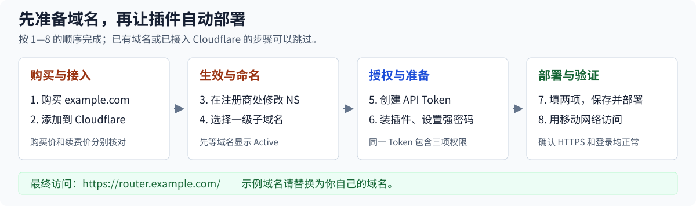
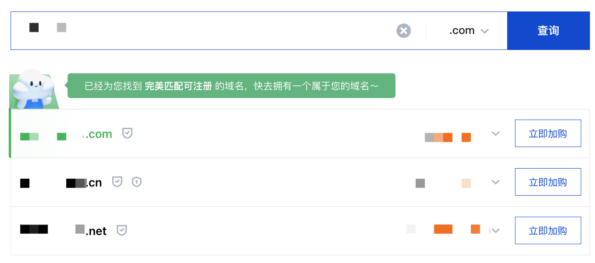
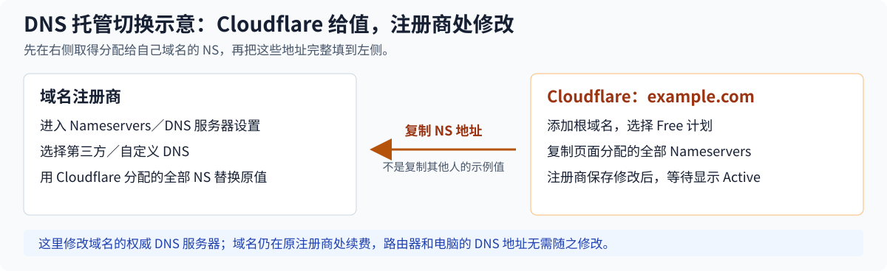
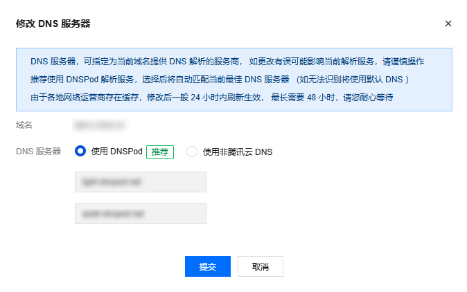
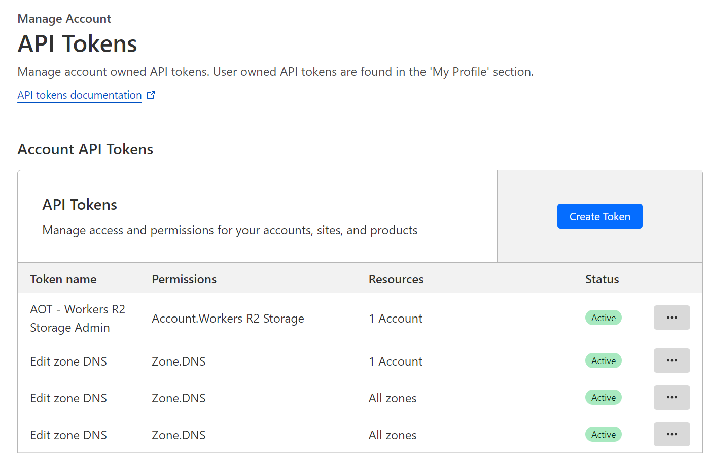
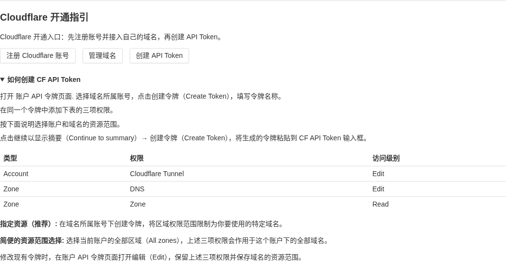
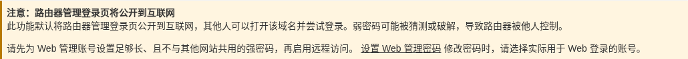
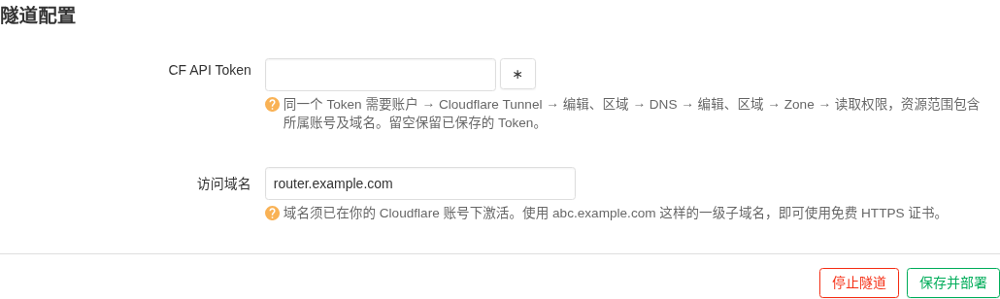
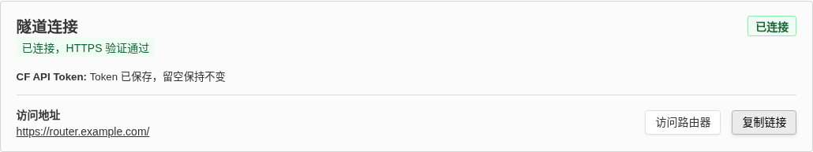
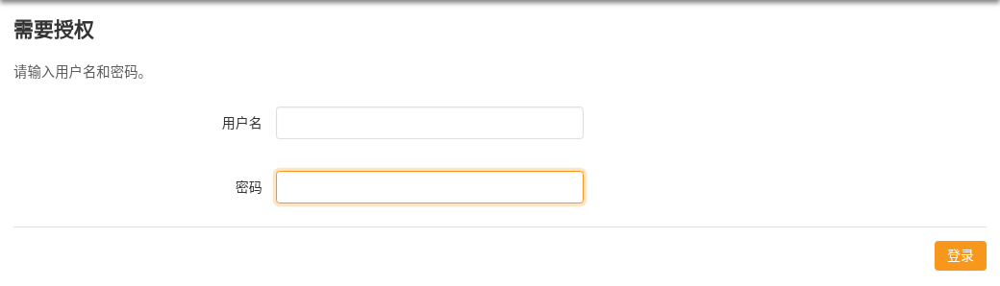

# X-WRT Cloudflare Tunnel 教程：从购买域名到远程访问路由器

本教程面向第一次使用 Cloudflare 的用户。完成后，即使路由器没有公网 IP，也可以在外面打开自己的域名，访问家中路由器的 Web 管理页面。

本文参考了[腾讯云开发者社区的内网穿透教程](https://cloud.tencent.com/developer/article/2686104)，并根据 `luci-app-cloudflare-tunnel` 插件改写操作步骤。域名接入 Cloudflare 后，只需在插件中填写 **CF API Token** 和 **完整访问域名**，插件会自动创建隧道、配置解析并启动连接，无需按照参考文章手动运行 Docker。

[](docs/images/setup-flow.svg)

图 1：完整操作路线。先准备域名和 Token，最后让插件自动完成隧道部署。

本文统一使用以下示例，请替换为你自己的域名：

| 项目 | 示例 | 用途 |
| --- | --- | --- |
| 购买的域名 | `example.com` | 添加到 Cloudflare，管理 DNS 解析 |
| 给路由器分配的访问域名 | `router.example.com` | 填入插件的“访问域名” |
| 最终访问地址 | `https://router.example.com/` | 在手机、电脑浏览器中打开 |

`example.com` 是文档示例域名，不能直接用来部署。已有域名的用户可以跳过购买步骤；域名已经在 Cloudflare 显示为 **Active（有效）** 的用户，可以从第四步开始。

点击图片可查看原图。配图包含官方界面示例和本插件实机截图。实机截图中的访问域名已在浏览器中替换为 `router.example.com`，登录页用户名已留空，图片不包含 Token 或密码。官方截图与现有控制台可能存在界面差异，[图片来源与说明](docs/images/README.md)中保留了原始出处。

## 第一步：购买一个属于自己的域名

选择一家支持修改 **DNS 服务器／Nameservers／NS** 的域名注册商。下面以腾讯云为例，其他注册商的操作思路相同。

1. 注册并登录域名注册商账号，进入域名注册页面。腾讯云用户可以从[单个域名注册指引](https://cloud.tencent.com/document/product/242/9595)进入。
2. 搜索自己喜欢的域名，例如自己名字的拼音加上一个后缀。先确认域名可以注册。
3. 核对完整拼写、购买年限、首年价格和**后续每年的续费价格**，再决定购买。首年优惠价不代表续费价。
4. 按注册商要求填写域名持有人信息，完成必要的身份、邮箱验证及付款。腾讯云的账号与信息模板要求见[购买方式说明](https://cloud.tencent.com/document/product/242/18873)。
5. 等待域名注册成功，确认能够在“我的域名”中找到它，并能进入 DNS 服务器设置页面。
6. 保存注册商账号和域名到期时间，按需设置到期提醒或自动续费。

[](docs/images/tencent-domain-search.png)

图 2：查询到可注册的域名后，核对名称和价格，再点击“立即加购”。图中名称、价格是官方示例，实际购买与续费价格以注册商当前页面为准。图片来源：[腾讯云单个域名注册指引](https://cloud.tencent.com/document/product/242/9595)。

本教程使用 Cloudflare 免费计划下的 DNS、Tunnel 和 Universal SSL 功能；域名的购买与续费仍由注册商收费。无需为这套部署额外购买云服务器、公网 IP 或付费证书。相关能力见 [Cloudflare Tunnel 官方说明](https://developers.cloudflare.com/tunnel/)和 [Universal SSL 官方说明](https://developers.cloudflare.com/ssl/edge-certificates/universal-ssl/)。

## 第二步：注册 Cloudflare 并添加域名

1. 打开 [Cloudflare 注册页面](https://dash.cloudflare.com/sign-up)，创建账号并按提示验证邮箱。
2. 登录 [Cloudflare 控制台](https://dash.cloudflare.com/)，选择用来管理这个域名的账户。
3. 找到添加／接入域名的入口，输入购买的根域名，例如 `example.com`，选择 **Free（免费）** 计划。
4. 检查 Cloudflare 导入的 DNS 记录。已有网站或邮箱的域名，需要核对原来的 A、AAAA、CNAME、MX 和 TXT 等记录是否完整。
5. 继续操作，记下 Cloudflare 为这个域名分配的 Nameservers。后面需要将它们填写到域名注册商处。

新域名暂时没有网站解析记录也可以继续，插件会在部署时创建路由器对应的记录。接入流程见 [Cloudflare 添加域名指引](https://developers.cloudflare.com/fundamentals/manage-domains/add-site/)，已有记录的核对见[完整 DNS 接入说明](https://developers.cloudflare.com/dns/zone-setups/full-setup/setup/)。

[](docs/images/dns-setup.svg)

图 3：这里是操作关系示意图。**Cloudflare 给出 NS 地址，域名注册商保存 NS 修改**，两个平台各有一步需要操作。

## 第三步：将域名的 DNS 服务器改为 Cloudflare

这里修改的是**域名注册商处的权威 DNS 服务器**，不是路由器或电脑上填写的 `1.1.1.1`、`8.8.8.8` 等 DNS 地址。

1. 回到购买域名的平台，打开这个域名的管理页面，找到“DNS 服务器”“修改 DNS”或“Nameservers”。
2. 如果原来开启了 DNSSEC，先按注册商和 Cloudflare 的指引关闭旧的 DNSSEC，避免旧签名影响解析。域名激活后可以再通过 Cloudflare 开启。
3. 选择自定义／第三方 DNS，将原来的 Nameservers 替换为上一步 Cloudflare 分配的全部地址。直接复制当前域名页面给出的值，不要照抄其他人的地址。
4. 保存修改，返回 Cloudflare 检查域名状态。

腾讯云用户可参考[修改 DNS 服务器](https://cloud.tencent.com/document/product/242/62106)，在域名管理中选择使用非腾讯云 DNS，再填写 Cloudflare 分配的地址。其他注册商请使用各自的 Nameservers 设置入口。

[](docs/images/tencent-nameservers.png)

图 4：截图展示默认选项，**本教程要改选右侧“使用非腾讯云 DNS”**，再填写 Cloudflare 分配的全部 NS 地址并提交。图片来源：[腾讯云修改 DNS 服务器说明](https://cloud.tencent.com/document/product/242/62106)。

等待 Cloudflare 域名状态变成 **Active（有效）** 后，再继续配置插件。NS 更新并非保存后立即生效，等待时间以注册商和 Cloudflare 的提示为准，以实际状态作为继续部署的依据。DNSSEC 和生效检查详见[官方接入说明](https://developers.cloudflare.com/dns/zone-setups/full-setup/setup/)。

更换 DNS 托管后，域名仍在原注册商处续费，无需为此办理域名转移。

## 第四步：选择路由器的访问域名

建议从一个尚未使用的一级子域名开始，例如 `router.example.com`。

| 填写示例 | 是否适合本插件的免费证书流程 | 原因 |
| --- | --- | --- |
| `router.example.com` | 适合 | 相对于 `example.com` 只有一级子域名 |
| `home-router.example.com` | 适合 | 连字符不会增加域名层级 |
| `001122aabbcc-dns.example.com` | 适合 | 可以用 MAC 去掉冒号后作为名称的一部分 |
| `mac.dns.example.com` | 不适合 | 相对于 `example.com` 有两级子域名 |
| `example.com` | 不适合 | 本插件要求使用子域名，避免占用根域名 |
| `https://router.example.com/` | 不适合 | 输入框只填写域名，不带协议或路径 |

采用本教程的完整 DNS 接入方式时，免费的 Universal SSL 默认覆盖根域名及其一级子域名。插件会按匹配到的 Cloudflare 区域检查域名层级，详见[官方证书覆盖说明](https://developers.cloudflare.com/ssl/edge-certificates/universal-ssl/limitations/)。

**此时不必手动添加指向家庭公网 IP 的 A 记录，也不必提前创建隧道。** 选好名称，交给插件自动部署即可。已有同名 DNS 记录时，插件会检查归属；遇到冲突会报错，保留原记录。

## 第五步：创建 Cloudflare API Token

插件需要的是 **Cloudflare API Token**，用于管理隧道和 DNS。参考文章中从 `cloudflared` 安装命令里复制的 **Tunnel Token** 是运行某条隧道的凭据，不能填到插件的 API Token 输入框；Global API Key 也不适用。

### 1. 打开账户 API 令牌页面

打开[账户 API 令牌页面](https://dash.cloudflare.com/?to=/:account/api-tokens)，选择**域名所属的 Cloudflare 账户**，点击 **Create Token（创建令牌）**。如需选择创建方式，使用自定义令牌，名称可以填写 `X-WRT Router`。

也可以在控制台中进入 **Manage account → Account API tokens**。看不到创建入口时，检查账户是否选对，以及当前成员是否有创建账户令牌的权限，参见[账户 API Token 官方说明](https://developers.cloudflare.com/fundamentals/api/get-started/account-owned-tokens/)。

[](docs/images/cloudflare-account-tokens.png)

图 5：在**账户级 API Tokens** 页面点击右侧 **Create Token**。图中现有令牌的名称和权限仅用于展示列表，配置时使用下文的三项权限。图片来源：[Cloudflare 官方博客的账户令牌示例](https://blog.cloudflare.com/account-owned-tokens-automated-actions-zaraz/)（2024 年发布，当前入口以本节链接为准）。

### 2. 给同一个 Token 添加三项权限

| 类型 | 权限项目 | 访问级别 | 用途 |
| --- | --- | --- | --- |
| Account（账户） | Cloudflare Tunnel | Edit（编辑） | 创建、读取和配置本机隧道 |
| Zone（区域） | DNS | Edit（编辑） | 创建和更新路由器的 DNS 记录 |
| Zone（区域） | Zone | Read（读取） | 自动查找域名及所属账户 |

三个权限需要同时存在。官方 API 文档有时使用 `Write` 表示写权限，控制台可能显示 `Edit`；可对照 [Tunnel API 部署指引](https://developers.cloudflare.com/cloudflare-one/networks/connectors/cloudflare-tunnel/get-started/create-remote-tunnel-api/)及[权限列表](https://developers.cloudflare.com/fundamentals/api/reference/permissions/)核对。

[](docs/images/xwrt-token-guide.png)

图 6：插件内的“Cloudflare 开通指引”也提供官方入口和权限表。展开“如何创建 CF API Token”，可边看指引边到 Cloudflare 配置。

### 3. 选择资源范围

- **推荐：指定域名。** 在域名所属账户创建 Token，将区域资源限制为具体域名，例如 `example.com`。
- **简便选择：当前账户的全部区域。** 选择 **All zones**，仍然只授予上面的三项权限，适合同一账户下有多个域名的情况。

如果页面要求选择账户资源，应包含域名所属账户。只授权另一个账户，或只授权其他域名，都会导致部署失败。

如果设置了来源 IP 限制，允许的应是**路由器访问互联网时的出口 IP**，不是 `192.168.x.x` 这样的局域网地址。家庭宽带出口 IP 可能变化，使用限制前需考虑这种情况；设置有效期时也要记下到期时间。相关规则见 [Token 使用限制](https://developers.cloudflare.com/fundamentals/api/how-to/restrict-tokens/)。

### 4. 生成并保存 Token

点击 **Continue to summary → Create Token**，复制生成的 Token 完整字符串，妥善保存，准备填入插件。不要复制令牌名称、整条命令或 `Bearer ` 前缀，也不要把 Token 发到公开截图、帖子或聊天群中。

## 第六步：安装插件并设置路由器强密码

### 安装插件

先用局域网连接路由器，打开平时使用的 X-WRT 管理地址。如果“服务”菜单中已经有 **Cloudflare 隧道**，可以直接使用。

没有该菜单时，在固件的软件包管理页面搜索并安装 `luci-app-cloudflare-tunnel`，让包管理器同时安装 `cloudflared` 等依赖。通过 SSH 安装、且软件源已提供本插件时，也可以使用对应命令：

使用 `apk` 的固件：

```sh
apk update
apk add luci-app-cloudflare-tunnel
```

使用 `opkg` 的固件：

```sh
opkg update
opkg install luci-app-cloudflare-tunnel
```

使用与本机固件匹配的软件源和软件包。如果搜索不到插件，请使用已集成该插件的固件，或由固件提供方提供相应安装包；自行编译的方法见 [README](README.md#build)。安装后重新打开管理页面，必要时按 `Ctrl+F5` 清除页面缓存。

### 设置实际 Web 登录账号的强密码

**部署后，路由器管理登录页将公开到互联网。别人只要知道域名，就能打开页面并尝试登录；弱密码可能导致路由器被他人控制。HTTPS 证书不会代替登录验证。**

[](docs/images/xwrt-password-warning.png)

图 7：部署前先点击“设置 Web 管理密码”，为实际使用的 Web 登录账号设置强密码。

在路由器的管理密码页面，为**实际用于 Web 登录的账号**设置足够长、且不与其他网站共用的强密码。登录名取决于固件构建和实际配置，按你平时登录这台路由器使用的账号操作。插件页面也提供“设置 Web 管理密码”链接。

修改后先在局域网验证新密码能够正常登录，再继续部署。插件会检查 Web 登录配置中的空密码，但不会替你判断现有密码是否足够强。

## 第七步：填写两项信息，保存并部署

1. 打开 **服务 → Cloudflare 隧道**。
2. 在 **CF API Token** 中粘贴第五步生成的 API Token。
3. 在 **访问域名** 中输入第四步选好的完整域名，例如 `router.example.com`。
4. 点击 **保存并部署**，等待页面状态变化。

[](docs/images/xwrt-settings.png)

图 8：首次部署需填写 Token 和完整子域名。此图是已保存 Token 后的界面，因此 Token 输入框为空；只改域名时留空即可保留原 Token。示例域名换成你自己的实际域名。

插件会依次查找域名区域、创建或复用本机隧道、配置 DNS 和路由、启动 `cloudflared`，最后验证 HTTPS。DNS 和证书尚未就绪时可能需要等待，先查看状态及错误说明。

[](docs/images/xwrt-connected.png)

图 9：等待出现绿色“已连接，HTTPS 验证通过”，再使用下方的“访问路由器”和“复制链接”。截图中的域名已替换为文档示例。

| 页面显示 | 含义与下一步 |
| --- | --- |
| 绿色“已连接，HTTPS 验证通过” | 可以点击“访问路由器”进行验证 |
| 橙黄色部署进度或“等待 HTTPS 验证” | 等待连接、DNS 更新或证书就绪，必要时稍后重新部署 |
| 红色“部署失败” | 按错误信息检查 Token、域名和网络，修正后重试 |
| 灰色“尚未配置”“已停止”或“未连接” | 尚未部署，或连接未建立；结合下方进度判断 |

页面每 **8 秒**刷新状态。连接状态和部署结果分开显示：如果更新失败但旧隧道仍在运行，可能同时看到绿色“已连接”和红色“部署失败”，应以具体错误和当前访问地址判断。

出现 **“Token 已保存，留空保持不变”** 表示凭据已经保存。再次打开页面时输入框为空是正常行为，接口不会把保存的 Token 返回给浏览器；只修改域名时可以留空。更换 Token 时，粘贴新值后重新保存并部署即可。

## 第八步：用手机移动网络验证远程访问

1. 在插件页面点击 **复制链接**，保存 `https://router.example.com/`。
2. 在手机上关闭 Wi-Fi，改用移动数据，打开这个地址。
3. 确认浏览器没有证书警告，显示的是自己路由器的登录页面。
4. 使用平时的 Web 管理账号和刚设置的强密码登录，确认可以正常查看管理页面，验证完退出登录。

[](docs/images/xwrt-public-login.png)

图 10：通过公网域名打开后，仍需使用实际 Web 管理账号和强密码登录。图中用户名、密码均为空；远程验证时，按上面的步骤在手机移动网络完成操作。

能在移动网络完成这些操作，就说明远程访问已经可用。后续直接访问这个 HTTPS 地址即可；部署成功后，插件会启用隧道服务及开机启动。

## 日常使用：多台设备、更换域名和停止访问

**多台路由器可以使用同一个已接入的根域名。** 给每台设备选择不同的子域名，例如 `router-a.example.com`、`router-b.example.com`，分别在各自设备上部署。可以为每台设备创建独立 API Token，便于单独撤销权限。

插件按设备保存资源归属，只清理自己创建且仍与记录匹配的 DNS，不会因为 B 设备改名就删除 A 设备的记录。给新设备部署时，应独立初始化插件；不要把 A 设备的 `/etc/cloudflare-tunnel/` 状态目录和插件配置直接复制给 B 设备当作新部署。

更换访问域名时，修改“访问域名”后点击“保存并部署”，成功后使用页面显示的新地址；原 Token 有效且资源范围包含新域名时可以留空。

暂时不用时点击 **停止隧道**，确认后本机连接及开机启动会关闭，Cloudflare 端的隧道和 DNS 记录仍保留，便于以后复用。恢复时点击“保存并部署”。彻底移除时，先停止，再到 Cloudflare 核对并删除本机对应的 DNS 记录和隧道，避免删除其他设备使用的资源。

## 常见问题

### 1. 找不到域名，或提示没有匹配的有效区域

先确认 Cloudflare 中域名为 **Active**，再核对 Token 是否在域名所属账户创建、具有 **Zone → Zone → Read** 权限，且资源范围包含该域名。插件填写的是 `router.example.com`，Cloudflare 中添加的是 `example.com`。

### 2. API 返回认证失败、无权限或 HTTP 403

检查是否粘贴了正确的 API Token，是否过期，以及三项权限和资源范围是否齐全。如果限制了来源 IP，确认当前路由器出口 IP 仍被允许。修正现有令牌或生成新令牌后，在插件中重新保存并部署。

### 3. 提示域名已有 DNS 记录或隧道不归本插件管理

换一个尚未使用的子域名最简单。需要保留原名称时，先在 Cloudflare 核实冲突记录或隧道的用途，再自行处理。插件会保留不属于自己的资源，不会自动接管或覆盖它们。

### 4. 隧道已连接，但 HTTPS 仍未验证通过

先检查域名层级是否符合第四步要求，再到 Cloudflare 的域名 **SSL/TLS → Edge Certificates（边缘证书）** 页面查看 Universal SSL 是否启用并已签发。官方说明，完整 DNS 接入的域名激活后，证书签发可能需要 15 分钟至 24 小时，见[证书启用说明](https://developers.cloudflare.com/ssl/edge-certificates/universal-ssl/enable-universal-ssl/)。

如果插件已验证公网 HTTPS，但本机浏览器仍打开旧网站，可能是本地 DNS 缓存尚未更新。等待缓存刷新，或换用移动网络验证，再按需重新部署。不要通过忽略浏览器证书警告来完成验证。

### 5. 一直连接中，或出现隧道连接错误

确认路由器能正常上网、解析域名和访问 Cloudflare API，并检查系统时间。Tunnel 需要向 Cloudflare 发起 **7844 端口的出站连接**：QUIC 使用 UDP，HTTP/2 使用 TCP；相关要求见[官方防火墙说明](https://developers.cloudflare.com/cloudflare-one/networks/connectors/cloudflare-tunnel/configure-tunnels/tunnel-with-firewall/)。这里检查的是出站通信，无需为路由器管理页开放 WAN 入站端口。

### 6. 出现 HTTP 502，或提示本地管理服务不可达

先在局域网确认路由器 Web 管理页面正常。本插件默认连接本机 `http://127.0.0.1:80`，会处理管理页跳转到 HTTPS 的情况。如果自行改过管理端口，需要同步调整插件的本地服务地址，操作见 [README 的运行说明](README.md#runtime)。

### 7. 如何查看诊断信息

通过 SSH 登录路由器后，可以执行：

```sh
/usr/libexec/cloudflare-tunnel status
logread -e cloudflared
```

向他人求助时，保留状态和错误信息，并隐藏 API Token、隧道凭据、登录密码和会话 Cookie。

## 参考资料

- [腾讯云开发者社区：原文参考](https://cloud.tencent.com/developer/article/2686104)。本文采用插件自动部署流程，购买和设置步骤以对应服务商及上述官方文档为准。
- [腾讯云：域名注册新手指引](https://cloud.tencent.com/document/product/242/49743)。
- [Cloudflare：域名完整 DNS 接入](https://developers.cloudflare.com/dns/zone-setups/full-setup/setup/)。
- [Cloudflare：账户 API Token](https://developers.cloudflare.com/fundamentals/api/get-started/account-owned-tokens/)。
- [Cloudflare：通过 API 部署 Tunnel](https://developers.cloudflare.com/cloudflare-one/networks/connectors/cloudflare-tunnel/get-started/create-remote-tunnel-api/)。
- [Cloudflare：Universal SSL 覆盖范围](https://developers.cloudflare.com/ssl/edge-certificates/universal-ssl/limitations/)。

教程核对日期：2026-10-31。控制台界面名称可能调整，请按域名管理、账户 API 令牌等功能入口查找。
